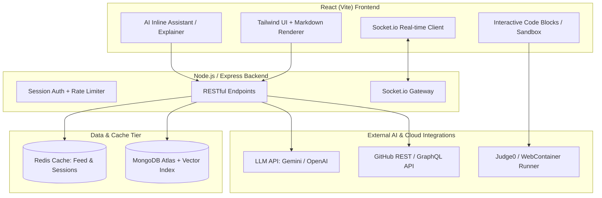
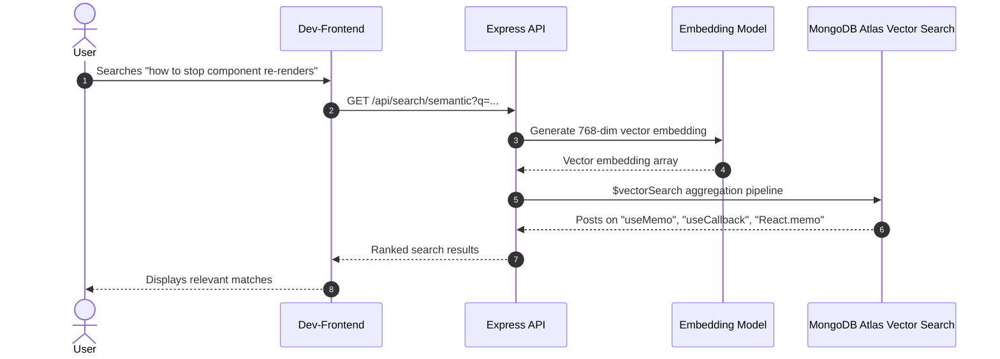
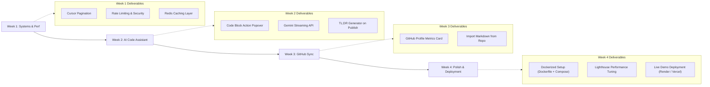

# DevConnect: High-Impact Project Roadmap (Internship & Placement Edition)

> [!IMPORTANT]
> The purpose of this guide is to transform **DevConnect** from a standard CRUD blog into a **production-grade, engineering-heavy portfolio project** that stands out to recruiters and senior engineers in 2026.

---

## 1. System Architecture Evolution



---

## 2. Standout Feature Specifications

### Feature A: AI-Powered Inline Code Assistant
*Instead of a generic chatbot, integrate AI directly into developer content.*

* **Concept**:
  * In every blog post with code blocks (` ```javascript `, ` ```python `, etc.), render an interactive toolbar with:
    * **"Explain Logic"**: Explains time & space complexity, tricky syntax, and design patterns.
    * **"Optimize Snippet"**: Suggests modernized syntax (e.g. converting callbacks to `async/await`, migrating JS to TypeScript).
    * **"Generate Unit Test"**: Writes Jest/Mocha test cases for the selected snippet.
* **Architecture & Tech Stack**:
  * **Frontend**: Custom Markdown code renderer (`react-syntax-highlighter` or `prismjs`) with an action popover.
  * **Backend**: Express streaming endpoint using SSE (`Server-Sent Events`) calling Gemini API / OpenAI API.
* **Resume Bullet**:
  > *"Engineered streaming AI code assistant integrated into Markdown parser, delivering real-time algorithmic complexity analysis and code modernization recommendations."*

---

### Feature B: Semantic & Hybrid Vector Search
*Move beyond basic string matching to intent-based search.*



* **Concept**:
  * Traditional regex searches miss articles if the exact words aren't matched.
  * Vector search matches **meaning and intent**. An inquiry on *"managing heavy background tasks"* discovers articles on *"BullMQ, Redis queues, and worker threads"*.
* **Implementation Details**:
  * Generate embeddings on post creation using free Gemini `text-embedding-004` or HuggingFace embeddings.
  * Store the embedding array in `Post.embedding`.
  * Create a Vector Index in MongoDB Atlas.
* **Resume Bullet**:
  > *"Implemented hybrid search pipeline pairing MongoDB text search with vector embeddings to achieve semantic content discovery."*

---

### Feature C: Live GitHub Portfolio Sync & Markdown Import
*Tailor the app specifically for developer workflows.*

* **Concept**:
  * **Profile Showcase**: Public developer profiles automatically pull pinned repositories, top languages, stargazers, and commit heatmaps via GitHub's GraphQL API.
  * **One-Click Publish**: Developers can provide a GitHub raw README URL or select a repository file to import directly as a formatted blog post.
* **Implementation Details**:
  * Add an optional `githubUsername` field to the `Dev` model.
  * Fetch data using `@octokit/rest` with server-side caching (1-hour TTL) so GitHub API rate limits are never exceeded.
* **Resume Bullet**:
  > *"Integrated GitHub GraphQL API with multi-tiered caching to sync open-source metrics and automate Markdown blog publishing."*

---

### Feature D: Interactive In-Browser Code Runner
*Turn static code snippets into executable playgrounds.*

* **Concept**:
  * Allow readers to click **"▶ Run Code"** on Python or JavaScript snippets directly inside a post.
* **Implementation Options**:
  1. **Option 1 (Zero Backend Overhead)**: Client-side execution in an isolated Web Worker / Sandboxed `<iframe>` for JavaScript.
  2. **Option 2 (Multi-Language)**: Free tier of **Judge0 API** for compiling/running Python, C++, Java, or Go.
* **Resume Bullet**:
  > *"Constructed client-side sandboxed execution environment enabling readers to test and execute interactive code blocks inline."*

---

### Feature E: Production Systems Engineering (The Interview Goldmine)
*This is the section that turns standard interview questions into senior-level discussions.*

| Area | Feature | Why It Impresses Interviewers |
| :--- | :--- | :--- |
| **Caching** | Redis caching for feed & profile reads | Demonstrates understanding of DB bottlenecks, cache invalidation, and TTL strategies. |
| **Pagination** | Cursor-based pagination (`createdAt` + `_id`) | Shows why standard `skip/limit` pagination degrades at high scale (O(N) vs O(1)). |
| **Realtime** | Socket.io notifications & "Live Readers" counter | Demonstrates event-driven architecture and persistent bi-directional communication. |
| **Security** | `express-rate-limit`, Helmet, Markdown sanitization (DOMPurify) | Proves defense against DDoS, credential stuffing, and stored XSS vulnerabilities. |

---

## 3. Recommended 4-Week Implementation Roadmap



---

## 4. How to Pitch DevConnect in Interviews (Elevator Pitch)

> *"DevConnect is an end-to-end developer content and community platform built on React, Node.js, and MongoDB. While it provides full publishing capabilities, I engineered it specifically around developer workflows: it features an in-line AI code assistant for algorithmic complexity and refactoring, semantic vector search for concept-based content discovery, and GitHub API synchronization for live developer portfolios. On the backend, I optimized feed throughput using cursor pagination and Redis caching, protected endpoints with rate limiting, and maintained safe client-side execution for interactive code snippets."*
